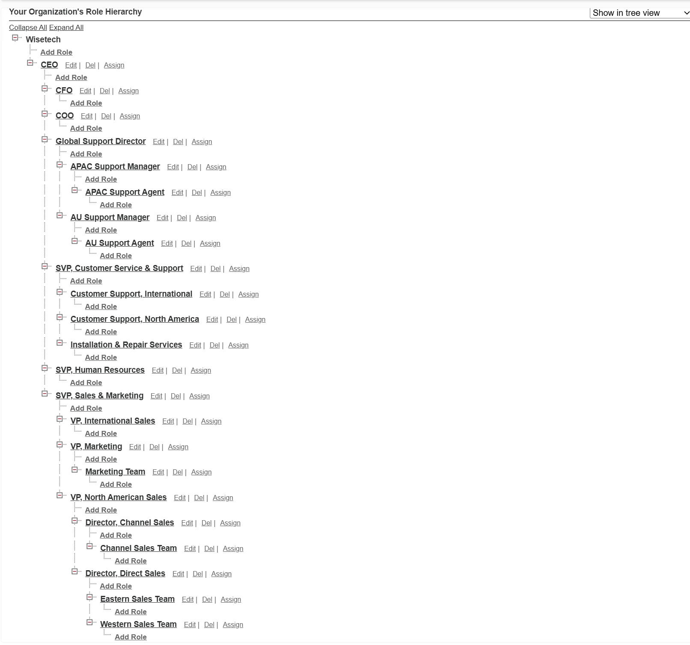
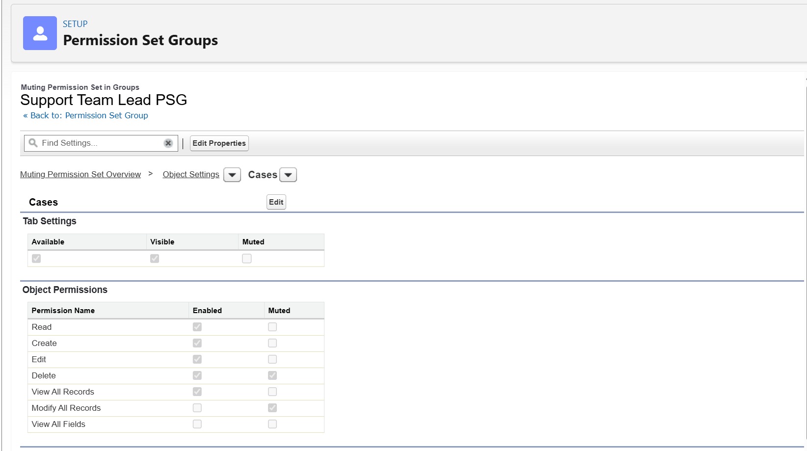
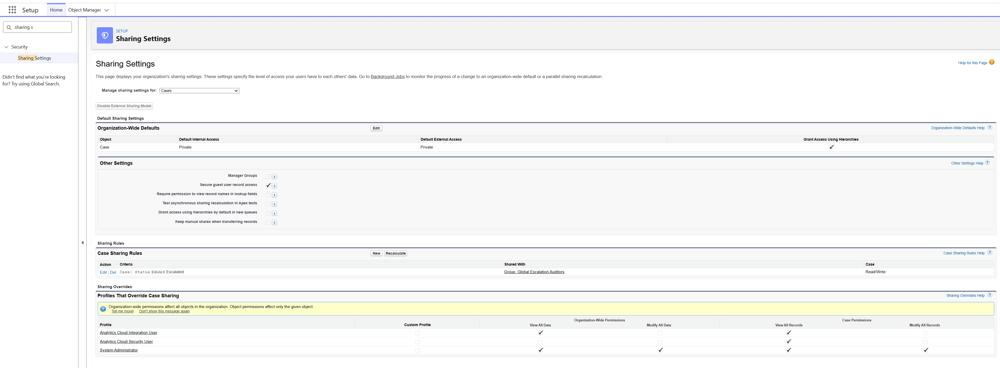
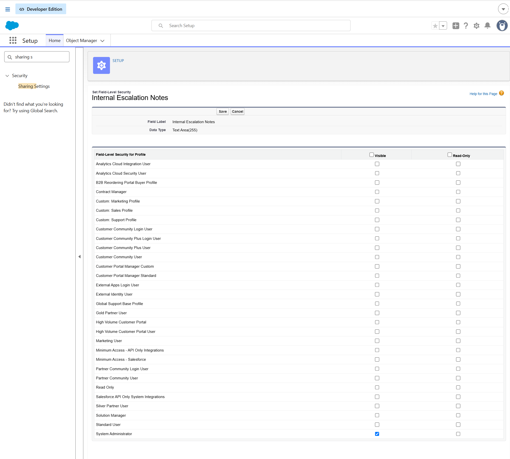
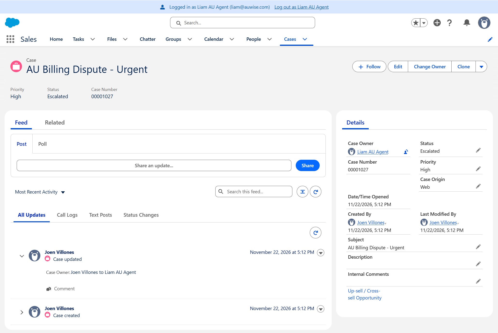

# 🛡️ Salesforce Enterprise Support Security Architecture (Capstone Lab)

> **Domain Focus:** Salesforce Administration – Domain 1: Configuration & Setup (20%)  
> **Target Roles:** Salesforce Administrator | L2/L3 Application Support Specialist  
> **Environment:** Salesforce Developer Edition / Trailhead Playground  

---

## 📌 Business Scenario & Problem Statement
A global SaaS organization operates regional support teams across **APAC** and **Australia (AU)**. Previously, all support agents had open visibility into global customer cases and unrestricted object permissions, creating compliance risks, accidental record deletions, and exposure of confidential escalation notes.

### **Architectural Objectives:**
1. Enforce the **Principle of Least Privilege** using a thin base Profile and modular **Permission Sets**.
2. Implement **Permission Set Groups (PSG) with Muting** to grant Team Lead visibility while preventing audit trail deletion.
3. Isolate regional case data (**APAC vs. AU**) using **Organization-Wide Defaults (OWD)** and **Role Hierarchy**.
4. Automate cross-functional escalation visibility using **Public Groups**, **Queues**, and **Criteria-Based Sharing Rules**.
5. Restrict sensitive internal notes via **Field-Level Security (FLS)**.
6. Validate security posture through live **Penetration Testing (`Login As`)** and document **L3 Root Cause Analysis (RCA)** for UI/Layout regressions.

---

## 🏗️ Security Architecture Blueprint

```text
                       [ CEO / System Admin ]
                                 │
                   [ Global Support Director ] ──► (Member of: Global Escalation Auditors Public Group)
                      /                   \
      [ AU Support Manager ]         [ APAC Support Manager ]
               │                                │
       [ AU Support Agent ]             [ APAC Support Agent ]
       (Test User: Liam)                (Isolated Region)

-------------------------------------------------------------------------
RECORD ACCESS LAYERS (CASE OBJECT):
1. OWD Baseline:        Private (Strict regional isolation)
2. Vertical Roll-up:    Role Hierarchy (Managers see subordinate cases)
3. Horizontal Share:    Criteria-Based Sharing Rule (Status = 'Escalated' 
                        ──► Read/Write to 'Global Escalation Auditors')
4. Workload Routing:    Queue ('AU Urgent Escalation Queue' -> AU Roles)
-------------------------------------------------------------------------
```

---

## ⚙️ Implementation Summary

### 1. Structural Access & Workload Routing
* **Role Hierarchy:** Built a 3-tier regional support tree (`Global Support Director` → `AU/APAC Support Managers` → `AU/APAC Support Agents`).
* **Public Group (`Global Escalation Auditors`):** Created a cross-functional auditor group (`Grant Access Using Hierarchies` enabled) for escalated incident oversight.
* **Queue (`AU Urgent Escalation Queue`):** Configured Case ownership queue assigned to `AU Support Manager` and `AU Support Agent` roles.

### 2. Object-Level Security (RBAC & Least Privilege)
* **Base Profile (`Global Support Base Profile`):** Cloned from `Minimum Access - Salesforce` to ensure zero default object permissions.
* **Modular Permission Sets (License: `--None--` for cross-license reusability):**
  * `Support_Case_Standard_Access`: Grants `Read`, `Create`, `Edit` on Cases + `Lightning Experience User` system permission.
  * `Support_Escalation_Lead_Access`: Grants `View All` and `Delete` on Cases + FLS access to sensitive escalation fields.
* **Permission Set Group (`Support Team Lead PSG`) + Muting:** Bundled both Permission Sets for Team Leads and applied a **Muting Permission Set** (`Support_Team_Lead_PSG_Muted`) to revoke `Delete` access on Cases, preserving audit integrity.

### 3. Record-Level & Field-Level Security (FLS)
* **Organization-Wide Defaults (OWD):** Locked down `Case` Internal/External access from *Public Read/Write/Transfer* to **Private**.
* **Criteria-Based Sharing Rule (`Share Escalated Cases with Auditors`):** Automatically shares any Case where `Status equals Escalated` (`Read/Write`) with `Global Escalation Auditors`.
* **Field-Level Security (`Internal_Escalation_Notes__c`):** Created a custom `Text Area` field hidden from `Global Support Base Profile` and exposed exclusively to System Admins and `Support Escalation Lead Access` holders.

---

## 🧪 Live Penetration Testing & QA Matrix (`Login As` Liam AU Agent)

| Test Case ID | Security Layer Tested | Expected Behavior | Actual Result | Status |
| :--- | :--- | :--- | :--- | :--- |
| **TC-01** | **OWD Isolation (`Private`)** | `Liam AU Agent` cannot view `APAC Server Outage - Confidential` owned outside his role branch. | Record hidden from *All Open Cases* list view. | ✅ PASS |
| **TC-02** | **Record Ownership** | `Liam AU Agent` can view and edit `AU Billing Dispute - Urgent` assigned to him. | Record accessible with Edit capabilities. | ✅ PASS |
| **TC-03** | **Field-Level Security (FLS)** | `Internal Escalation Notes` field is hidden from `Liam AU Agent` on the Case Details tab. | Field completely omitted from UI layout. | ✅ PASS |
| **TC-04** | **Object Delete Restriction** | `Liam AU Agent` does not have the `Delete` action button on Case records. | `Delete` option absent from record action menu. | ✅ PASS |

---

## 🛠️ L3 Application Support Troubleshooting Logs (RCA)

During user acceptance and penetration testing with the cloned `Minimum Access - Salesforce` profile, two real-world configuration regressions were identified and resolved:

### **Incident #1: User Forced into Salesforce Classic UI on Impersonation**
* **Symptom:** Logging in as `Liam AU Agent` defaulted to Salesforce Classic without access to the Lightning App Launcher or Cases tab.
* **Root Cause:** The `Minimum Access - Salesforce` baseline profile lacks the `Lightning Experience User` system permission by default.
* **Resolution:** Added `Lightning Experience User` to the `Support_Case_Standard_Access` Permission Set, restoring modern Lightning UI navigation while keeping the base profile minimal.

### **Incident #2: Missing Page Layout Error on Case Details Tab**
* **Symptom:** Opening a Case record as `Liam AU Agent` threw an error on the Details component: *"One or more profiles have no page layout assigned for the 'Case' Object."*
* **Root Cause:** Cloned `Minimum Access` profiles do not inherit default Page Layout assignments for standard objects.
* **Resolution:** Navigated to `Object Manager → Case → Page Layouts → Page Layout Assignment` and mapped `Global Support Base Profile` to `Case Layout`.

---

## 📂 Key Salesforce Metadata Components Configured
* `Profile`: `Global Support Base Profile`
* `PermissionSet`: `Support_Case_Standard_Access`, `Support_Escalation_Lead_Access`
* `PermissionSetGroup`: `Support_Team_Lead_PSG` (+ Muting Permission Set)
* `Role`: `Global_Support_Director`, `AU_Support_Manager`, `APAC_Support_Manager`, `AU_Support_Agent`, `APAC_Support_Agent`
* `Group`: `Global_Escalation_Auditors`
* `Queue`: `AU_Urgent_Escalation_Queue`
* `SharingCriteriaRule`: `Share_Escalated_Cases_with_Auditors`
* `CustomField`: `Case.Internal_Escalation_Notes__c`

---

## 📸 Configuration & Penetration Test Screenshots

### 1. Enterprise Role Hierarchy (AU vs. APAC Isolation)


### 2. Permission Set Group + Muting (Revoking Delete Access)


### 3. OWD Lockdown (`Private`) & Criteria-Based Sharing Rule


### 4. Field-Level Security (`Internal Escalation Notes`)


### 5. Live Penetration Test (`Login As` Liam AU Agent)

